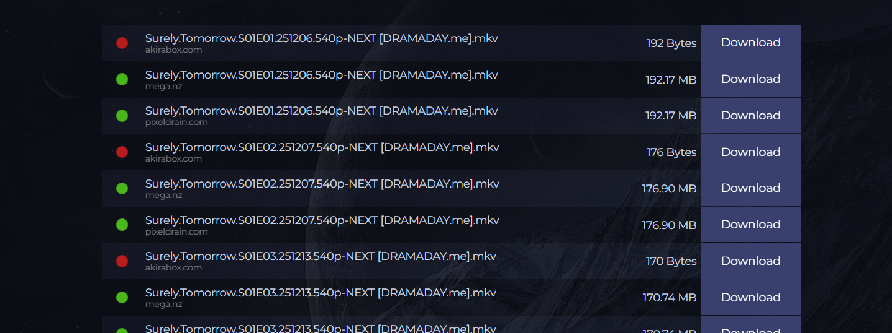
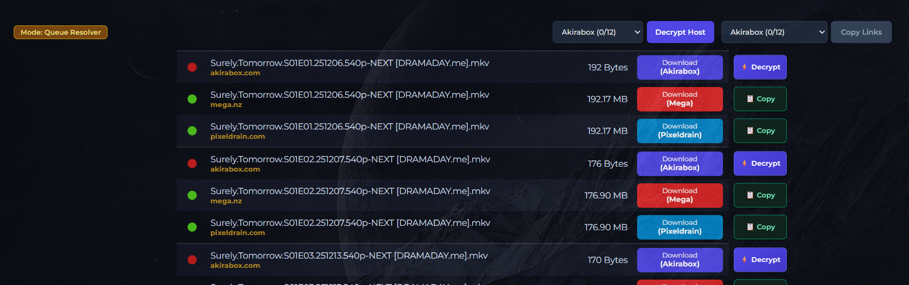

---

#### Filecrypt Instant Decrypter, Bypass & Auto-Resolver
A high-speed, automated link decrypter for Filecrypt containers. Built with native WebCrypto AES-CBC decryption for Click'n'Load (CNL) containers, multi-worker parallel queuing, early-abort network inspection, and isolated per-task retry logic.

---

> ### ⚠️ Current Status & Known Issues
>
> Filecrypt recently updated their captcha and bot protection, which has broken this script's manual link resolver. 
>
>Currently, **Instant Decryption** will still work perfectly if Click'n'Load (CNL) data is present on the page. However, if CNL is missing and the script attempts to manually decrypt the hosts, it will fail. I am aware of this issue, but I will not have the time to investigate a bypass or push a fix for a while.

---

### 📸 Preview

#### Before (Standard Filecrypt)

#### After (With Instant Decrypter & Auto-Resolver)

---

### Features

* **Zero-Latency Click'n'Load (CNL) Engine:** Decrypts container packages entirely in-browser using native Web Crypto (`crypto.subtle` AES-CBC), unlocking links instantaneously with zero server requests.
* **4-Worker Multi-Threaded Queue:** Resolves fallback links via 4 parallel asynchronous workers, calibrated with randomized humanized jitter (`200ms–350ms`) to evade Cloudflare rate limits and HTTP 429 throttling.
* **Early-Abort Header Interception:** Intercepts HTTP `Location` headers at `readyState === 2` and aborts connections immediately, eliminating redundant HTML body downloads and reducing network overhead.
* **Isolated Per-Task Retry Pipeline:** Failed or throttled hops trigger an isolated 2-pass auto-retry cycle without blocking the main worker queue or triggering infinite loops.
* **Dynamic Host Grouping & Formatting:** Aggregates links by provider with color-coded tags and one-click bulk export, including native translation for Pixeldrain fast CDN mirrors (`cdn.pixeldrain.eu.cc`).
* **SPA & Cloudflare Resilient:** Features a self-polling DOM observer that initializes automatically once background security challenges or asynchronous table loads complete.

---

### Supported Domains

- `filecrypt.cc`
- `filecrypt.to`
- `filecrypt.co`
- `filecrypt.org`
- `filecrypt.is`

---

### Interface Controls

* **Mode Badge:** Real-time indicator of the script's current state (e.g., `Instant CNL`, `Auto-Retrying`, or `Ready`).
* **Batch Decrypt & Copy:** Select a specific host from the dropdown to decrypt only those links. Once resolved, 1-click copy exports them all (including pre-formatted Pixeldrain CDN links).
* **↻ Retry Failed:** Appears automatically to let you re-queue failed links without resetting your completed progress.
* **Individual Row Actions:** Use **⚡ Decrypt** or **📋 Copy** on specific rows for precision control, or click the main Download pill once it resolves.
* **Row Pinning:** Click anywhere on a row to highlight it for easy visual tracking across large lists.

---

### About & Maintenance

This is a personal hobby project that I originally built for my own day-to-day use. I decided to publish it on Greasy Fork so other users could benefit from it as well. 

Because it is a personal hobby project, updates will not follow a regular schedule. I will maintain and update it whenever I have free time or when changes affect my own usage.

---

### License

This userscript is distributed under the [MIT License](https://github.com/ArvindSaini978/userscripts/blob/main/LICENSE).
